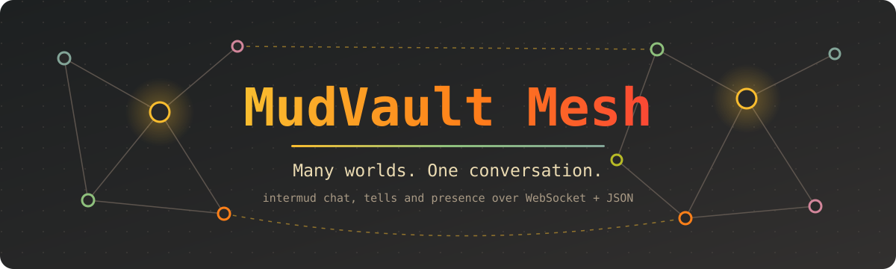
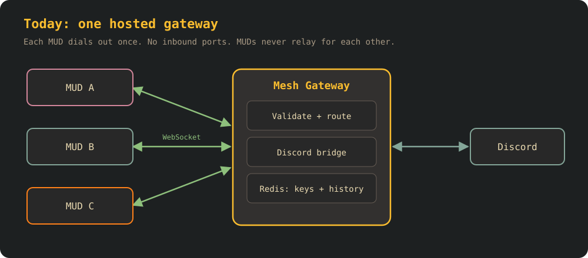
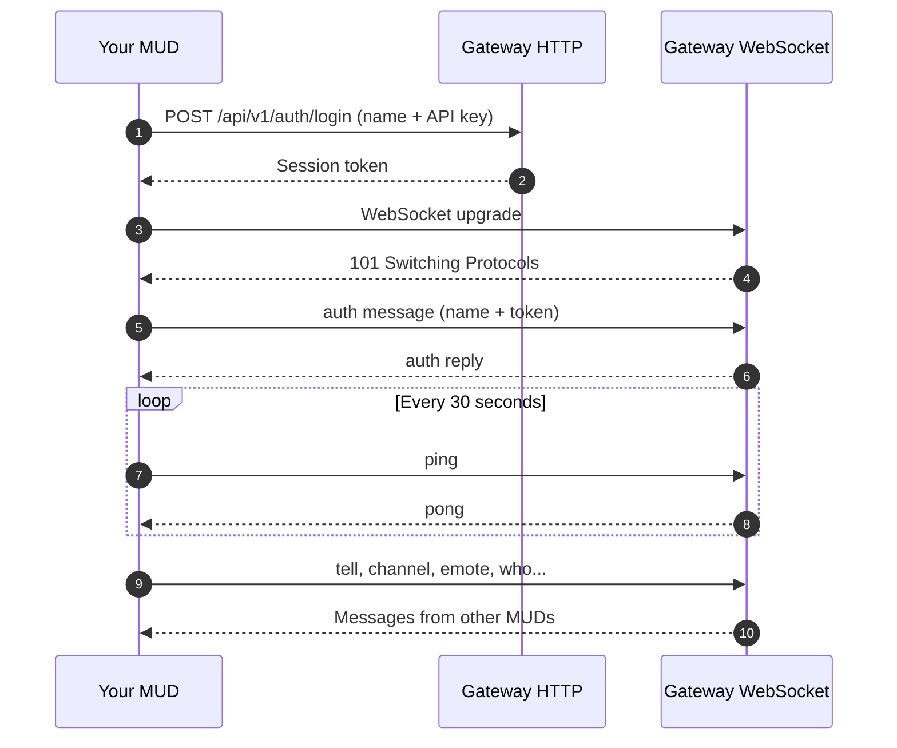
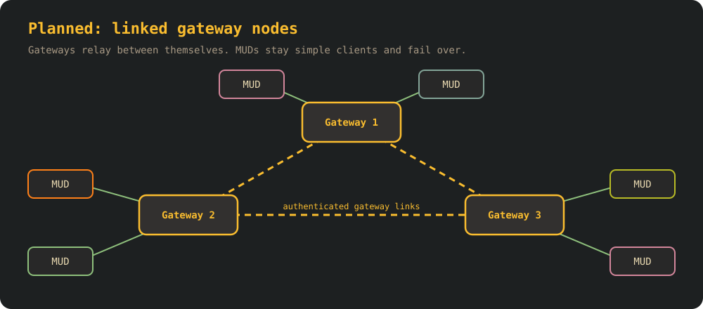

<div align="center">



<br>

[](#-project-status)
[](docs/PROTOCOL.md)
[](#-run-your-own-gateway)
[](package.json)
[](https://discord.gg/r6kM56YrEV)

**An open intermud network that lets players on different MUDs talk to each other.**
<br>
Built on plain WebSockets and JSON, so any codebase that can open a socket can join.

[How it works](#-how-it-works) · [Features](#-features) · [Protocol](#-the-protocol) · [Self-host](#-run-your-own-gateway) · [Roadmap](#-roadmap) · [Contribute](#-contributing)

</div>

---

> [!IMPORTANT]
> **The hosted network is in private preview and is not accepting outside MUDs yet.** We are finishing connection security first. Follow along or ask about early access in [Discord](https://discord.gg/r6kM56YrEV).

## ✦ Why MudVault Mesh?

MUD communities are small, scattered, and full of people who would enjoy meeting each other. Intermud networks have connected them for decades, but they often depend on old protocols that are hard to implement in a modern codebase.

MudVault Mesh keeps the idea and modernizes the plumbing:

<table>
<tr>
<td width="33%" valign="top">

### 🔌 Simple to join
One **outbound** connection. No port forwarding, no inbound firewall rules, and no relaying traffic for other games.

</td>
<td width="33%" valign="top">

### 🧾 Readable by design
Every message is a small **JSON** envelope. You can debug it by eye and implement it in any language.

</td>
<td width="33%" valign="top">

### 🌉 Bridged to Discord
Channels can reach **Discord**, so a community's conversation does not have to stop at the game's edge.

</td>
</tr>
</table>

## ⚙ How it works

<p align="center">
  
</p>

Your MUD logs in once, opens a WebSocket, and stays connected. The gateway validates every message and routes it to the right place:

| You send to | What the gateway does |
| :-- | :-- |
| **A specific MUD** | Forwards the message to that MUD |
| **`*`** | Broadcasts it to every other connected MUD |
| **`Gateway`** | Answers directly, for things like the MUD list |

### Connecting, step by step



### So why is it called a *mesh*?

Because that is where it is going. The goal is a network of **linked gateway nodes** with no single point of failure. **Today there is one gateway**, so the network is hub-and-spoke for now.

<p align="center">
  
</p>

> [!NOTE]
> A MUD is never a relay, today or in the planned design. MUDs stay simple clients, and gateways do the routing.

## ◈ Features

**Legend:** 🟢 working · 🟡 partial · 🔵 planned

| | Feature | Notes |
| :-: | :-- | :-- |
| 🟢 | **Tells** | Private messages, such as `alice@other-mud` |
| 🟢 | **Channels** | `ooc`, `chat`, `gossip`, `newbie`, and `admin` |
| 🟢 | **Emotes** | Actions to a player or across the network |
| 🟢 | **Who and finger** | Requests are forwarded to the target MUD to answer |
| 🟢 | **MUD and channel lists** | See what is connected right now |
| 🟢 | **Discord bridge** | Maps mesh channels to Discord channels |
| 🟢 | **Authenticated sessions** | Admin-issued API keys, hashed with bcrypt, plus verified login tokens |
| 🟢 | **Connection limits** | Login timeouts and per-IP and per-connection limits |
| 🟢 | **Message validation** | Strict schemas and size limits on every message |
| 🟡 | **Locate** | The message exists, but results are not yet player-accurate |
| 🟡 | **Presence** | Defined in the protocol, not yet wired through clients |
| 🟡 | **Client libraries** | Node.js and Python packages need updating for the login flow |
| 🟡 | **Automated tests** | Unit and gateway tests run in CI, with more coverage to come |
| 🔵 | **TLS encryption** | See the [roadmap](#-roadmap) |
| 🔵 | **MudVault accounts and bans** | See the [roadmap](#-roadmap) |
| 🔵 | **Multi-gateway mesh** | See the [roadmap](#-roadmap) |

## ✉ The protocol

Every message, of every type, uses the same envelope:

```json
{
  "version": "1.0",
  "id": "7f1b6c1e-2d0a-4b53-9a51-0f3c8a4a9d11",
  "timestamp": "2026-11-23T08:00:00.000Z",
  "type": "channel",
  "from": { "mud": "your-mud", "user": "alice", "displayName": "Alice" },
  "to": { "mud": "*", "channel": "ooc" },
  "payload": { "channel": "ooc", "message": "Hello, mesh!", "action": "message" },
  "metadata": { "priority": 5, "ttl": 300, "encoding": "utf-8", "language": "en" }
}
```

<details>
<summary><b>Message types</b></summary>

<br>

| Type | Purpose | Payload |
| :-- | :-- | :-- |
| `tell` | Private message | `{ message }` |
| `emote` / `emoteto` | Action | `{ action, target? }` |
| `channel` | Channel message | `{ channel, message, action }` |
| `who` | Who is online | `{ request: true }` or `{ users: [...] }` |
| `finger` | Player details | `{ user, request: true }` or `{ user, info }` |
| `locate` | Find a player | `{ user, request: true }` |
| `presence` | Status change | `{ status, activity?, location? }` |
| `mudlist` | Connected MUDs | `{ request: true }` |
| `channels` | Available channels | `{ request: true }` |
| `auth` | Session login | `{ mudName, token }` |
| `ping` / `pong` | Heartbeat | `{ timestamp }` |
| `error` | Something failed | `{ code, message }` |

</details>

<details>
<summary><b>Limits and rules</b></summary>

<br>

| Rule | Value |
| :-- | :-- |
| MUD names | 3 to 32 letters, numbers, dashes, or underscores |
| Channel names | 1 to 32 letters, numbers, dashes, or underscores |
| Message text | 4,096 characters |
| Formatted text | 8,192 characters |
| WebSocket message | 64 KB |
| Heartbeat | Send every 30 seconds. Silent connections drop after 60 |
| Session token | 7 days |
| Message age | Dropped once older than its `ttl`, so keep your clock in sync |

</details>

<details>
<summary><b>Error codes</b></summary>

<br>

| Code | Meaning | Code | Meaning |
| :-: | :-- | :-: | :-- |
| `1000` | Invalid message | `1006` | Rate limited |
| `1001` | Authentication failed | `1007` | Internal error |
| `1002` | Unauthorized | `1008` | Protocol error |
| `1003` | MUD not found | `1009` | Unsupported version |
| `1004` | User not found | `1010` | Message too large |
| `1005` | Channel not found | | |

</details>

## ⚒ Run your own gateway

You need **Node.js 18+**, **Redis 6+**, and **OpenSSL**.

**1. Install and build**

```bash
git clone https://github.com/Coffee-Nerd/MudVault-Mesh.git
cd MudVault-Mesh
npm install
npm run build
```

**2. Configure it with fresh secrets**

```bash
cp .env.example .env
sed -i "s|^JWT_SECRET=.*|JWT_SECRET=$(openssl rand -hex 32)|" .env
sed -i "s|^DISCORD_ENABLED=.*|DISCORD_ENABLED=false|" .env
printf '\nADMIN_SECRET=%s\n' "$(openssl rand -hex 32)" >> .env
chmod 600 .env
```

**3. Start it**

```bash
npm start
```

**4. In a second terminal, check it and register a MUD**

```bash
curl http://localhost:8080/api/v1/health

curl -X POST http://localhost:8080/api/v1/auth/register \
  -H "Content-Type: application/json" \
  -d "{\"mudName\":\"My-Mud\",\"adminSecret\":\"$(grep ^ADMIN_SECRET .env | cut -d= -f2)\"}"
```

The reply contains your API key **once**, so save it somewhere private. With the example config, HTTP runs on `8080` and WebSocket on `8081`.

> [!WARNING]
> This setup is for **local development**. Do not expose a self-hosted gateway to the internet until the security items in the [roadmap](#-roadmap) are complete.

## ◆ Project status

| Area | Status |
| :-- | :-- |
| Core routing | 🟢 Running in production with Dark Wizardry |
| Discord bridge | 🟢 Running |
| Outside MUDs | 🟡 Private preview |
| Encryption | 🔵 Not yet. Do not send passwords or sensitive data over the mesh |
| Redundancy | 🔵 One gateway today |

## ➜ Roadmap

### Phase 1: Harden the gateway `in progress`

- [x] Close open registration and require an admin secret
- [x] Stop one failed Discord send from taking the gateway down
- [x] Stop storing private messages
- [x] Verify session tokens on every WebSocket login
- [x] Add connection, login, and message limits
- [x] Keep MUD server addresses private
- [ ] Encrypt all traffic with TLS
- [ ] Add IP and account bans with an audit trail

### Phase 2: Open the network

- [ ] Publish the full admin setup guide
- [ ] Add external uptime checks with Discord alerts
- [x] Repair CI
- [ ] Build a shared protocol test suite
- [ ] Release updated client libraries and a reference C client
- [ ] Welcome the first outside MUDs

### Phase 3: Connect the MudVault ecosystem

- [ ] Sign in with a MudVault account
- [ ] Chat on the mesh directly from the MudForge client
- [ ] Reduce per-message overhead in logging, parsing, and storage

### Phase 4: Become a true mesh

- [ ] Run a second gateway node
- [ ] Add authenticated gateway-to-gateway links
- [ ] Share the MUD registry, sessions, and bans between nodes
- [ ] Prevent duplicates and routing loops using message IDs
- [ ] Fail over automatically when a node goes down
- [ ] Sign messages so they can be verified across nodes

## ▤ Project layout

```text
MudVault-Mesh/
├── src/
│   ├── index.ts              Server startup
│   ├── routes/api.ts         HTTP API
│   ├── middleware/           Auth and rate limiting
│   ├── services/
│   │   ├── gateway.ts        WebSocket gateway and routing
│   │   ├── discord.ts        Discord bridge
│   │   ├── channel.ts        Channels
│   │   ├── user.ts           Users and presence
│   │   └── redis.ts          Storage
│   └── utils/                Validation, messages, logging
├── packages/                 Node.js, Python, and Discord packages
├── examples/dikumud/         Early C integration example
├── tests/                    Jest tests
└── docs/                     Protocol and API references
```

## ▣ Documentation

| Document | What is inside |
| :-- | :-- |
| [Protocol](docs/PROTOCOL.md) | Original protocol specification |
| [Commands](docs/COMMANDS.md) | JSON examples for each command |
| [HTTP API](docs/API.md) | REST endpoint reference |
| [Integration](docs/INTEGRATION.md) | Early notes on adding the mesh to a MUD |
| [Design](mudvault-mesh-design.md) | The original long-term vision |

> [!NOTE]
> Some older documents describe planned features as if they already exist. **This README is the source of truth for current status.**

## ♥ Contributing

MudVault Mesh is built by MUD people, for MUD people. Help is especially welcome with:

- **Client libraries** for C, C++, LPC, Rust, and Evennia
- **Integration guides** for specific codebases
- **Protocol tests** and wider test coverage
- **Gateway federation** design and review

Read the [contributing guide](CONTRIBUTING.md), open an [issue](https://github.com/Coffee-Nerd/MudVault-Mesh/issues), or come talk to us on [Discord](https://discord.gg/r6kM56YrEV).

> [!CAUTION]
> Please report security problems **privately** to a maintainer on Discord rather than in a public issue.

---

<div align="center">

**MudVault Mesh** is released under the MIT License.

<sub>Many worlds. One conversation.</sub>

</div>
